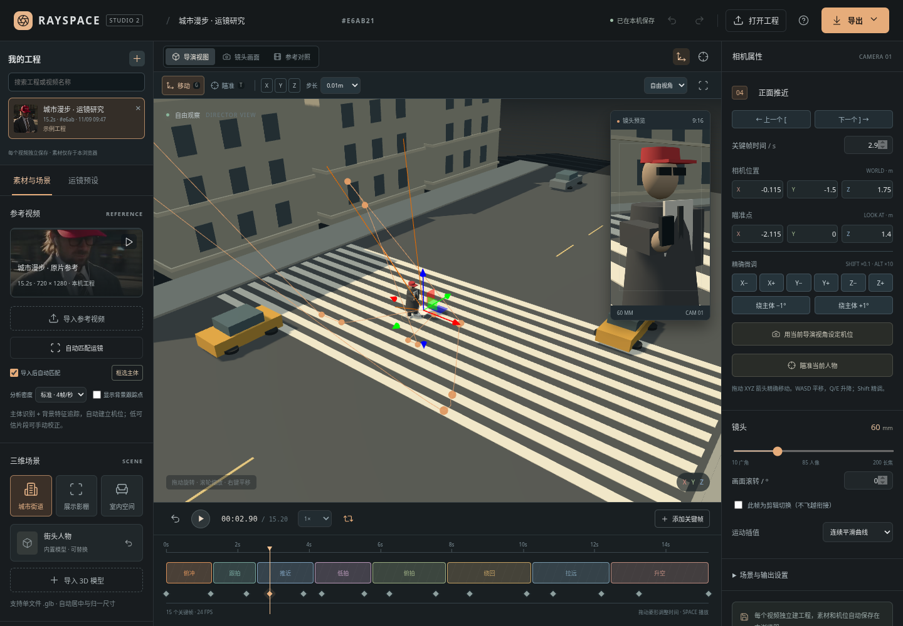

# RAYSPACE Studio 2 · 视频运镜预演工作室

每个参考视频独立建立工程，在浏览器本地识别人物、跟踪背景、估计运镜并生成可编辑三维机位。支持 GLB 模型、精细相机编辑和默认 MP4 导出。



## 开始使用

下载仓库中的 `downloads/RAYSPACE-Studio-2.zip`，解压后用新版桌面 Chrome 或 Edge 打开其中的 `RAYSPACE-Studio.html`。单文件已打包渲染引擎、人体模型权重和内置参考片，不依赖 CDN。受管理的浏览器可能禁止本地 HTML，可改用在线网页或下方的本地服务。

在线地址（需仓库已启用 Pages）：https://novpan356.github.io/RAYSPACE-3D/

网页构建发布在 `gh-pages` 分支。若未启用，在 https://github.com/novpan356/RAYSPACE-3D/settings/pages 中选择 **Deploy from a branch → gh-pages → / (root) → Save**。不要把已推送分支当成网站已启用的证据。

## 工程与素材

- 每次导入视频都会建立新的工程，不覆盖当前工程的参考片或机位。
- 左侧列表显示缩略图、文件名、独立编号、时长、创建时间和匹配状态；支持搜索与重命名。
- 每个工程的视频、GLB 模型和机位保存在本浏览器 IndexedDB 中，切换或重开后恢复。
- 素材不会因导入而上传 GitHub 或任何服务器；清除浏览器网站数据会清除工程库。存储空间不足会显示保存失败，需备份工程和素材。
- JSON 跨设备传递机位与分析参数，不包含视频或 GLB。打开 JSON 会建立独立工程，参考片明确标为待补充，不会偷偷套用另一视频。
- 旧版机位可迁移。旧版未存储原视频，无法凭空恢复，需在迁移工程中补充一次原片。

## 自动匹配如何工作

1. 按 4 或 8 帧/秒采样，单片最多 160 帧；长视频会降低有效采样密度。
2. 使用内置 MoveNet Lightning 识别人及骨架区域；非人物或未正确识别的主体可以在第一帧框选。
3. 将人体区域与背景分开，提取背景角点并进行多尺度块跟踪、前后向校验和 RANSAC 相似变换拟合，估计平移、尺度与画面滚转。独立运动区域与背景整体运动分别处理。
4. 在三维场景中生成新的相机位置、瞄准点、滚转和主体路径；不是沿用示例预设。可以在参考对照中显示主体框和背景匹配点。
5. 快速模糊、近景遮挡、纹理不足和疑似剪辑会降低可信度；低可信帧不会凭空积分为相机运动。背景不足时保留静止/原机位并标为待校正。

**边界：**这是单目视频的二维运动估计到三维预演的近似映射，不是 SLAM、深度重建或已标定相机求解。无法唯一确定真实焦距、物理尺度、推拉与变焦、平移与摇摄/环绕；不保证任意视频精确复现。人体模型是单人模型，多主体选择和非人物可用框选校正。运动区域未识别语义类别时不会显示成已识别人。低覆盖会显示“初步匹配 · 需校正”。

## 更精细的编辑

- 选择时间轴菱形或右侧“上一个 / 下一个”关键帧。
- **G / T** 切换移动相机或瞄准点，使用三维 XYZ 操作手柄。
- **X / Y / Z** 约束手柄拖动的轴，**Esc** 解除约束。
- 步长可选 **0.001、0.01、0.1、1 米或自由移动**。
- **WASD** 进行 XY 平移，**Q/E** 升降；**Shift** 精调到步长的 0.1 倍，**Alt** 快移到 10 倍。
- 数值输入实时预览；可横向拖动坐标标签微调，Esc 取消输入。
- **1 / 3 / 7** 前、侧、顶视；**F** 聚焦选中机位。
- 一键捕获导演视角、瞄准主体、绕主体旋转 1°（Shift 为 0.1°）。
- **[ / ]** 选择前后关键帧；**Space** 播放，**← / →** 前后逐帧。
- **Ctrl/Cmd+Z** 撤销，**Shift+Ctrl/Cmd+Z** 重做，**Ctrl/Cmd+S** 导出工程。
- 平滑模式使用保形三次 Hermite 曲线，在正常关键帧交界处保持连续速度并避免坐标过冲；疑似剪辑可设为切换，不飞越无关镜头。

所有键盘微调在输入框之外生效。常用机位与镜头参数直接可见，工程/场景高级设置折叠在下方。

## 导出

- **MP4 默认**：WebCodecs 逐帧渲染并封装为真实 MP4；720 像素高、24 FPS，宽度取偶数。优先 H.264，不支持时尝试 VP9/MP4；不支持编码器的浏览器会提示，绝不将 WebM 改扩展名伪装 MP4。
- **WebM 可选**：保留实时录制，实际流畅度受设备性能影响。
- **PNG / JSON / TXT**：镜头图片、工程与分镜提示词。

本地浏览器下载不依赖聊天界面的附件导出。MP4 渲染速度取决于设备，但时间戳和帧数按工程时间计算，不受实时播放掉帧影响。

## Higgsfield

仍提供用户指定的 3D Jutsu 页面入口和分镜提示词。未接入登录、上传或付费生成接口；JSON 是本应用工程格式，不是已验证的 Higgsfield 导入格式。

## 开发和验证

Node.js 24；依赖版本由 `package-lock.json` 固定。

```sh
npm ci
npm run dev
npm test
npm run build
npm run build:offline
```

`build:offline` 会同时更新单文件 HTML、版本化 ZIP 和兼容旧下载名的 ZIP，防止软件包落后于网页版本。

浏览器回归测试需 Python、Pillow、NumPy、Playwright、FFmpeg 和 `/usr/bin/chromium`；先启动服务：

```sh
STUDIO_URL=http://127.0.0.1:5173 python tests/browser_test.py
```

覆盖多工程隔离、素材持久化和恢复、相反方向视频的自动机位差异、真实人物识别、精调/快捷键、JSON 与错误输入、删除隔离、移动端布局，以及 MP4 的实际解码、编码格式、帧数、帧率和时长。

模型来源、许可及 SHA-256 位于 `src/models/`；分发许可见 `THIRD_PARTY_NOTICES.txt`。
